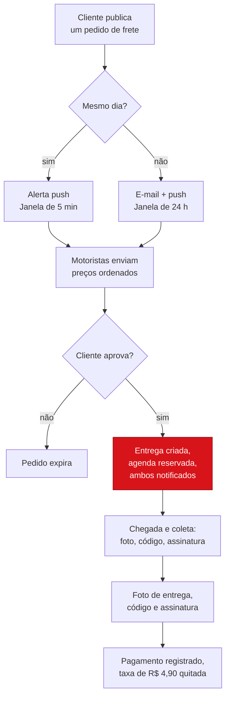
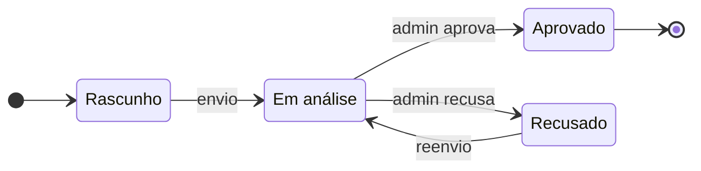
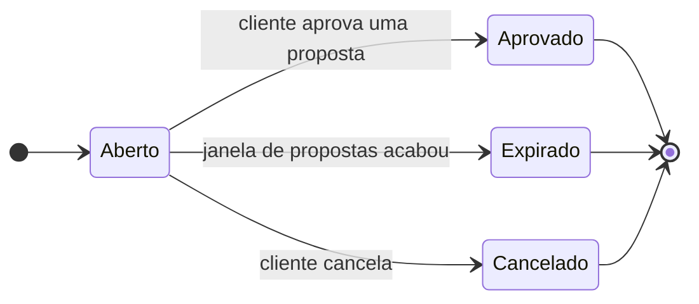
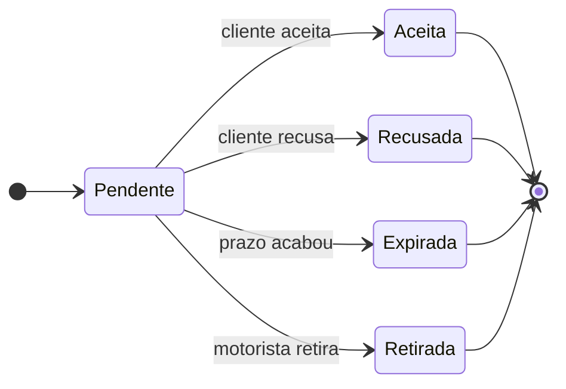
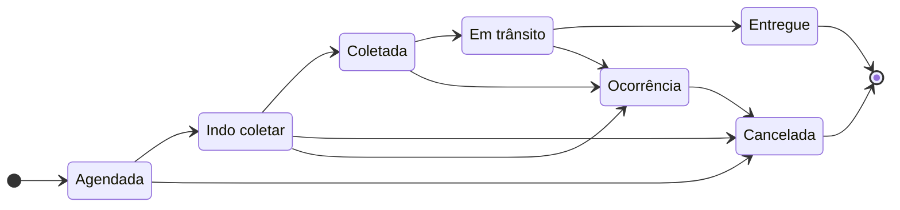
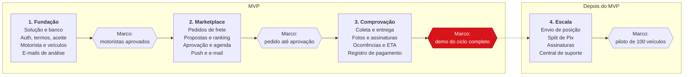
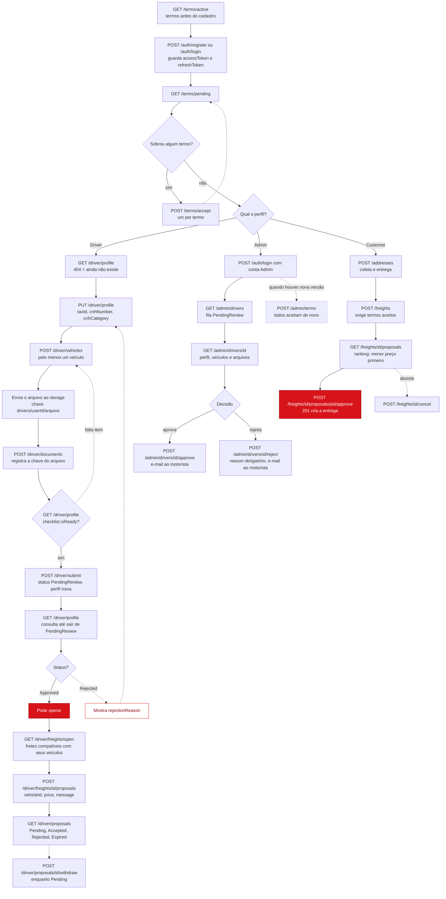
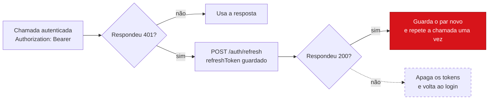

# Frota Online API

Marketplace de fretes para motoristas de veículos de carga (de Fiorino a caminhão e carreta), em que o motorista define o preço.
Monolito modular em **.NET 9**, com Clean Architecture, PostgreSQL e EF Core.

**Documentação:** rode a API e abra <https://localhost:62577/docs/index.html>
(ou <http://localhost:62578/docs/index.html>). As portas vêm de `src/FrotaOnline.Api/Properties/launchSettings.json`.
A página é um guia com um passo a passo em quatro paradas e uma lista de endpoints ao vivo, com console "Try it".

## Status

| Módulo | Situação |
| --- | --- |
| Domínio: 18 entidades com máquinas de estado de motorista, pedido, proposta e entrega | Pronto |
| Auth: cadastro, login, refresh com rotação, logout e usuário atual | Pronto |
| Termos: versões ativas, aceite com data e IP, publicação de nova versão (admin) | Pronto |
| Motorista: perfil (CPF ou CNPJ, inclusive alfanumérico, e CNH), veículos, documentos, checklist e envio para análise | Pronto |
| Admin: fila de análise, aprovar e rejeitar com motivo, e-mail ao motorista | Pronto |
| Endereços do cliente | Pronto |
| Pedidos de frete: criar, listar, cancelar, expirar | Pronto |
| Propostas do motorista, ranking por preço e aprovação que cria a entrega e reserva a agenda | Pronto |
| Andamento da entrega (coleta, trânsito, comprovante), pagamento e taxa | Próximo |

## Diagramas

### Ciclo do frete

Só uma proposta aprovada transforma o pedido em entrega.



### Máquinas de estado

Quatro máquinas de estado mantêm o marketplace consistente. As transições inválidas lançam `DomainException` no domínio.

**Cadastro do motorista**



**Pedido de frete**



**Proposta**



**Entrega**



Entregue e Cancelada são estados finais. Uma ocorrência pode interromper a entrega depois da ida à coleta, e só então ela pode ser cancelada.

### Roadmap

O MVP chega em três fases, cada uma fechada por um marco de demo. As fases estão em ordem, sem estimativa de duração.



## Requisitos

- SDK do .NET 9
- Docker (para o PostgreSQL local)

## Como rodar

```powershell
.\setup.ps1                      # solução, Postgres (docker), build e testes
```

Só na primeira vez, crie o esquema do banco. Pule a linha `add` se a pasta `src/FrotaOnline.Infrastructure/Persistence/Migrations` já existir.

```powershell
dotnet ef migrations add InitialCreate -p src/FrotaOnline.Infrastructure -s src/FrotaOnline.Api -o Persistence/Migrations
dotnet ef database update          -p src/FrotaOnline.Infrastructure -s src/FrotaOnline.Api
```

Depois, inicie a API (o Visual Studio faz o mesmo com o perfil `FrotaOnline.Api`):

```powershell
dotnet run --project src/FrotaOnline.Api
```

Em Development, a rota `/` redireciona para o guia da documentação.

## Endpoints de documentação

Disponíveis só em Development. Os três leem o mesmo contrato, então endpoints novos aparecem sem editar nenhuma página.

| URL | O que é |
| --- | --- |
| `/` e `/docs` | Redirecionam para `/docs/index.html`, o guia. Os arquivos ficam em `src/FrotaOnline.Api/wwwroot/docs`. |
| `/docs/index.pt.html` | O mesmo guia em português. Há um link de troca de idioma na barra lateral das duas versões. As descrições dos endpoints vêm do OpenAPI e ficam em inglês. |
| `/swagger` | Swagger UI padrão. |
| `/openapi/v1.json` | O documento OpenAPI bruto, gerado a partir dos controllers. |

Os endpoints protegidos mostram **Needs token**. No guia, conclua as paradas 1 e 2 e o token é enviado por você.
No Swagger UI, use **Authorize** e cole o `accessToken` de `/api/v1/auth/login`.

## Configuração por ambiente

O ambiente vem de `ASPNETCORE_ENVIRONMENT` (o Visual Studio define `Development` no `launchSettings.json`).
As configurações são aplicadas em camadas: `appsettings.json`, depois `appsettings.{Environment}.json`, depois variáveis de ambiente.

| Ambiente | Banco | Onde fica a string de conexão |
| --- | --- | --- |
| Development | `frotaonline` no Postgres local do Docker | `appsettings.Development.json` (só credenciais locais) |
| Staging | servidor e banco próprios | variável de ambiente `ConnectionStrings__Default` ou gerenciador de segredos |
| Production | servidor e banco próprios | variável de ambiente `ConnectionStrings__Default` ou gerenciador de segredos |

- O `appsettings.json` deixa `ConnectionStrings:Default` vazia de propósito. A API se recusa a iniciar em um ambiente que não tenha uma.
- `Jwt:SecretKey` segue a mesma regra: no mínimo 32 caracteres, diferente em cada ambiente e definida com `Jwt__SecretKey` fora do Development.
- Staging e Production usam emissor e audiência de JWT próprios, então um token de um ambiente não vale no outro.
- Para outro ambiente, rode `dotnet ef database update ...` com `ASPNETCORE_ENVIRONMENT` e `ConnectionStrings__Default` definidos.

Para manter a sua chave JWT de desenvolvimento fora do repositório:

```powershell
dotnet user-secrets init --project src/FrotaOnline.Api
dotnet user-secrets set "Jwt:SecretKey" "<no mínimo 32 caracteres aleatórios>" --project src/FrotaOnline.Api
```

## Estrutura do projeto

| Projeto | Responsabilidade | Depende de |
| --- | --- | --- |
| `FrotaOnline.Domain` | Entidades, enums, regras de negócio e máquinas de estado. | nada |
| `FrotaOnline.Application` | Casos de uso (serviços), DTOs, validadores e as interfaces de que os casos de uso precisam. | Domain |
| `FrotaOnline.Infrastructure` | EF Core, repositórios, JWT e hash de senha. Implementa essas interfaces. | Application |
| `FrotaOnline.Api` | Controllers, autenticação, OpenAPI e página de documentação. | Application, Infrastructure |
| `FrotaOnline.Tests` | Testes unitários das regras de domínio e do serviço de autenticação. | Application, Domain |

As interfaces ficam em `Application/Abstractions`, um arquivo por interface e uma pasta por módulo:

```
Abstractions/
  Auth/         IAuthRepository, IPasswordHasher, ITokenService, AccessTokenResult, RefreshTokenResult
  Users/        IUserRepository
  Persistence/  IUnitOfWork
  Time/         IDateTimeProvider
```

Ao adicionar um módulo (por exemplo, Freight), crie `Abstractions/Freight/IFreightRepository.cs` e implemente em `Infrastructure/Repositories`.

## Ordem de chamadas para o front-end

Todo usuário começa pelos termos e por uma sessão. Depois o caminho se divide pelo perfil da conta. As setas tracejadas são laços de volta a um passo anterior.



### Renovação de sessão

Qualquer chamada autenticada pode responder 401 quando o access token expira. Renove uma vez e repita a chamada. Cada refresh token vale uma única vez, então guarde o par novo: reutilizar um antigo encerra a sessão.



## Endpoints de autenticação (`/api/v1/auth`)

| Método | Rota | Descrição |
| --- | --- | --- |
| POST | `/register` | Cria uma conta de Customer ou Driver e devolve os tokens. |
| POST | `/login` | E-mail e senha. |
| POST | `/refresh` | Rotaciona o refresh token. Reutilizar um token já rotacionado revoga a sessão inteira. |
| POST | `/logout` | Revoga um refresh token (exige access token). |
| GET | `/me` | Claims do usuário atual (exige access token). |

Os access tokens são JWTs de 15 minutos. Os refresh tokens duram 30 dias, são aleatórios, ficam guardados apenas como hash SHA-256 e funcionam uma única vez.
As senhas precisam ter de 8 a 128 caracteres, com letra maiúscula, letra minúscula e dígito.

## Endpoints de termos (`/api/v1/terms`)

| Método | Rota | Acesso | Descrição |
| --- | --- | --- | --- |
| GET | `/active` | Público | Versão atual dos termos de uso e da política de privacidade. |
| GET | `/pending` | Logado | Termos ativos que o usuário ainda não aceitou. |
| GET | `/consents` | Logado | Histórico de aceites do usuário. |
| POST | `/accept` | Logado | Registra o aceite (data e IP). Aceitar duas vezes devolve o aceite original. |

## Endpoints do motorista (`/api/v1/driver`, perfil Driver)

| Método | Rota | Descrição |
| --- | --- | --- |
| GET | `/profile` | Perfil, status e checklist do que falta para enviar à análise. |
| PUT | `/profile` | Cria ou atualiza `taxId` (CPF ou CNPJ, numérico ou alfanumérico), CNH e categoria. O `taxId` é obrigatório para motorista e validado pelos dígitos verificadores antes de gravar. Só editável em rascunho ou depois de uma rejeição. |
| POST | `/submit` | Envia para análise (`PendingReview`). Exige termos aceitos, um veículo ativo e um documento. |
| GET / POST | `/vehicles` | Lista e cadastra veículos. Placa no formato `ABC1234` ou `ABC1D23`. |
| DELETE | `/vehicles/{id}` | Desativa um veículo. Um motorista aprovado mantém pelo menos um ativo. |
| GET / POST | `/documents` | Lista e registra arquivos já enviados ao storage. A chave precisa começar com `drivers/{userId}/`. |

## Endpoints do cliente (`/api/v1`, perfil Customer)

| Método | Rota | Descrição |
| --- | --- | --- |
| GET / POST | `/addresses` | Lista e cadastra endereços. UF válida e CEP com 8 dígitos. |
| POST | `/freights` | Cria o pedido: endereço de coleta e de entrega (diferentes e do próprio cliente), carga, peso (até 60 t), tipo de veículo e, opcional, `scheduledPickupAt` em UTC (com `Z`). Exige os termos aceitos. Sem data o frete é do dia e a janela de propostas é de 5 minutos; agendado, 24 horas. |
| GET | `/freights?status=` | Pedidos do cliente, com a quantidade de propostas pendentes. |
| GET | `/freights/{id}` | Detalhe do pedido. |
| POST | `/freights/{id}/cancel` | Cancela um pedido aberto e rejeita as propostas pendentes. |
| GET | `/freights/{id}/proposals` | Propostas pendentes ordenadas por preço (menor primeiro; empate pela mais antiga), com nome e veículo do motorista. |
| POST | `/freights/{id}/proposals/{proposalId}/approve` | Aprova a proposta: cria a entrega (`Scheduled`), reserva a agenda do motorista, rejeita as outras e fecha o pedido. Responde 201. |

## Endpoints do motorista no marketplace (`/api/v1/driver`, perfil Driver aprovado)

| Método | Rota | Descrição |
| --- | --- | --- |
| GET | `/freights/open` | Pedidos abertos e dentro da janela, só dos tipos dos seus veículos ativos (até 100). Mostra bairro e cidade da coleta e a cidade da entrega; o endereço completo não aparece antes da aprovação. |
| POST | `/freights/{freightId}/proposals` | Envia proposta: `vehicleId`, `price` (0 a 1.000.000, 2 casas) e `message`. Uma pendente por motorista e pedido. O veículo precisa ser ativo, do tipo pedido e comportar o peso. |
| GET | `/proposals` | Propostas do motorista. |
| POST | `/proposals/{proposalId}/withdraw` | Retira uma proposta pendente. |

### Regras do marketplace

- O motorista define o preço; a plataforma não mexe nele. A taxa de R$ 4,90 e o pagamento entram na próxima fase.
- A aprovação reserva a agenda do motorista por 4 horas a partir da coleta (`DeliveryPlanning.AgendaWindow`). Se já houver outra entrega nesse intervalo, devolve `proposal.driver_busy`.
- Um `BackgroundService` (`FreightExpirationWorker`, a cada 30 segundos) expira pedidos e propostas vencidos. Entre uma varredura e outra a API já recusa novas propostas fora da janela.
- O cliente aprova dentro da mesma janela da proposta. Em frete do dia isso dá 5 minutos; veja as decisões em aberto abaixo.

## Endpoints de administração (`/api/v1/admin`, perfil Admin)

| Método | Rota | Descrição |
| --- | --- | --- |
| GET | `/drivers?status=PendingReview` | Fila de análise, do mais antigo para o mais novo. |
| GET | `/drivers/{id}` | Dossiê completo: perfil, contato, veículos e arquivos. |
| POST | `/drivers/{id}/approve` | Aprova e envia e-mail. |
| POST | `/drivers/{id}/reject` | Rejeita com motivo obrigatório e envia e-mail. O motorista corrige e reenvia. |
| POST | `/terms` | Publica nova versão de um termo e desativa a anterior do mesmo tipo. |

Em Development, a API cria na primeira execução um admin (`Seed:Admin` em `appsettings.Development.json`) e a versão 1.0 dos termos. O upload de arquivos (URL pré-assinada) e o provedor real de e-mail ainda não existem: hoje o e-mail é gravado no log (`IEmailSender`).

A coluna `CpfNumber` do motorista virou `TaxId` (14 caracteres, único). Depois de atualizar, gere a migration:

```powershell
dotnet ef migrations add DriverTaxId -p src/FrotaOnline.Infrastructure -s src/FrotaOnline.Api -o Persistence/Migrations
dotnet ef database update -p src/FrotaOnline.Infrastructure -s src/FrotaOnline.Api
```

Se já existirem motoristas no banco, troque no arquivo gerado o `DropColumn`/`AddColumn` por `migrationBuilder.RenameColumn(name: "CpfNumber", table: "DriverProfiles", newName: "TaxId")` e o índice por `RenameIndex`, para não perder os dados.

## Erros

As falhas retornam problem details (RFC 7807). Leia o código de status e depois o `title`, que é um código estável:

| Status | `title` | Significado |
| --- | --- | --- |
| 400 | `validation_error` | Algum campo é inválido. O objeto `errors` lista quais. |
| 401 | `auth.invalid_credentials` | E-mail ou senha incorretos. |
| 401 | `auth.invalid_refresh_token` | Refresh token desconhecido, expirado ou já usado. |
| 403 | `auth.user_inactive` | A conta está desativada. |
| 409 | `auth.email_in_use` | Esse e-mail já tem uma conta. |
| 400 | `driver.submission_incomplete` | Falta termo, veículo ou documento. `errors` diz o que. |
| 403 | sem corpo | O perfil do usuário não pode usar o endpoint. |
| 404 | `driver.profile_not_found` | Crie o perfil do motorista primeiro. |
| 409 | `driver.profile_locked` | Perfil em análise ou aprovado não pode ser editado. |
| 409 | `driver.tax_id_in_use`, `driver.cnh_in_use`, `driver.plate_in_use` | Documento ou placa já cadastrados. |
| 409 | `admin.not_pending_review` | Só motoristas em análise podem ser aprovados ou rejeitados. |
| 409 | `terms.not_active` | A versão do termo foi substituída. Aceite a atual. |
| 403 | `freight.terms_not_accepted` | O cliente precisa aceitar os termos ativos antes de criar pedidos. |
| 404 | `freight.not_found`, `proposal.not_found` | Pedido ou proposta inexistente (ou de outro usuário). |
| 409 | `freight.not_open`, `freight.window_closed` | Pedido fechado, cancelado, expirado ou fora da janela de propostas. |
| 409 | `proposal.not_pending`, `proposal.already_submitted` | Proposta já decidida, ou o motorista já tem uma pendente neste pedido. |
| 403 | `proposal.driver_not_approved` | Só motorista aprovado envia propostas. |
| 409 | `proposal.driver_unavailable`, `proposal.vehicle_unavailable`, `proposal.driver_busy` | Motorista ou veículo inativo, ou agenda ocupada na aprovação. |
| 400 | `proposal.vehicle_not_eligible` | Veículo de outro tipo ou sem capacidade para o peso. |

## Testes

```powershell
dotnet test
```

## Decisões de projeto

- **SOLID:** os serviços dependem de interfaces definidas na Application. A Infrastructure as implementa, então trocar o hasher ou o formato do token mexe em uma única classe.
- **As regras de domínio ficam nas entidades:** setters privados, métodos de criação e transições explícitas. Movimentos inválidos lançam `DomainException`.
- **Constantes de negócio:** taxa da plataforma de R$ 4,90 por frete, janelas de proposta de 5 minutos (mesmo dia) e 24 horas (agendado), assinaturas de R$ 79,90 e R$ 99,90.
- **Falhas esperadas usam `Result<T>`;** a API as converte em respostas de problem details.
- **As chaves estrangeiras nunca apagam em cascata,** para que registros financeiros e de auditoria sobrevivam.
