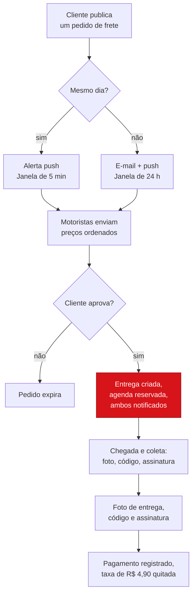
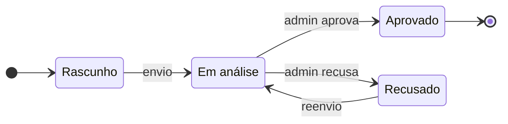
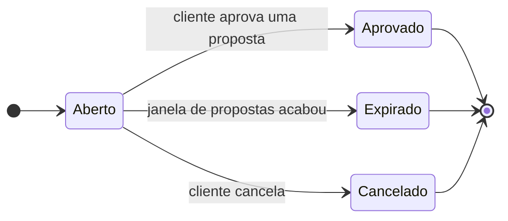
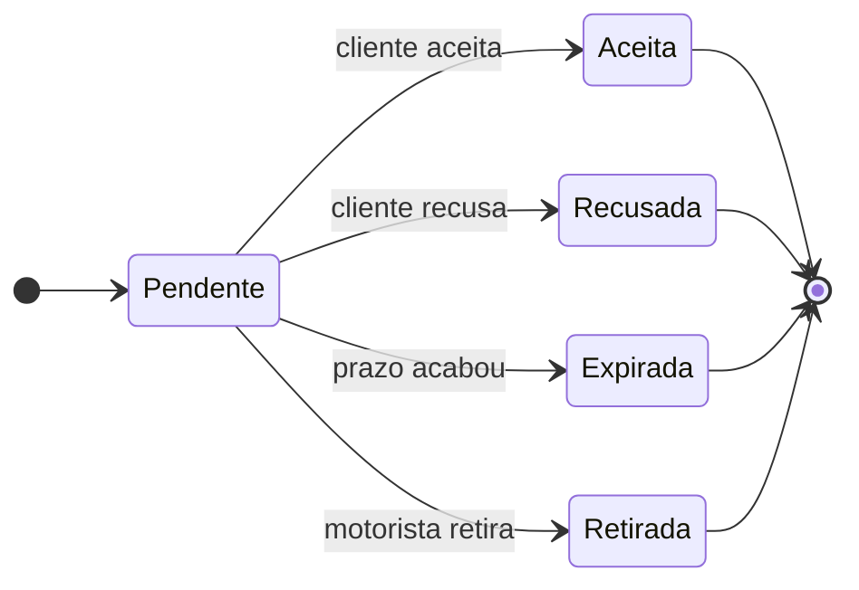
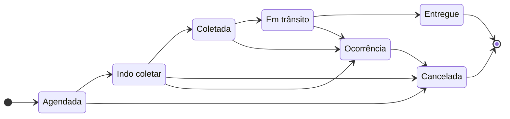
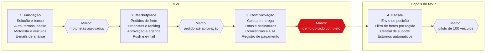
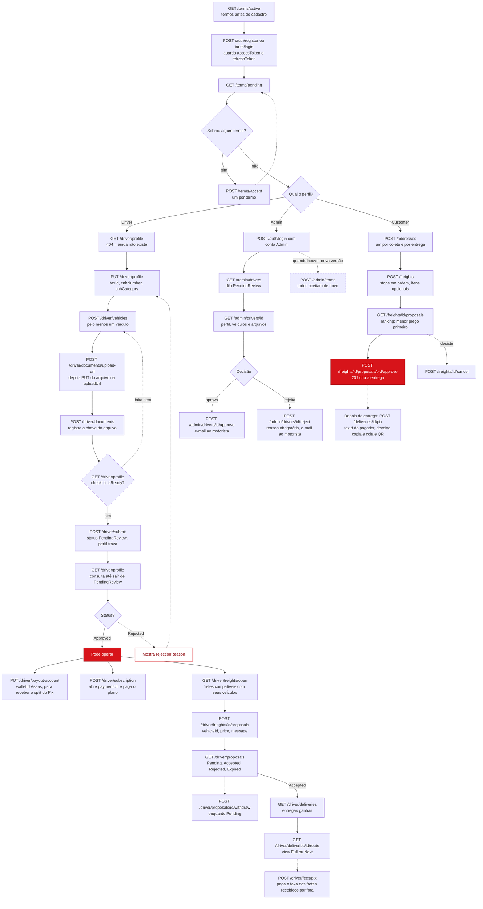
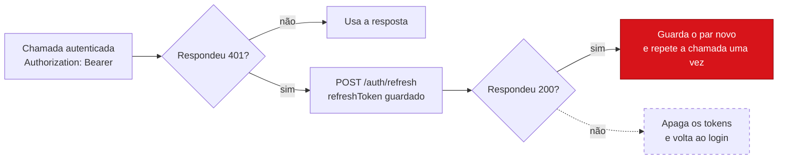

# Frota Online API

Marketplace de fretes para motoristas de veículos de carga (de Fiorino a caminhão e carreta), em que o motorista define o preço.
Monolito modular em **.NET 9**, com Clean Architecture, PostgreSQL e EF Core.

**Documentação:** rode a API e abra <https://localhost:62577/docs/index.html>
(ou <http://localhost:62578/docs/index.html>). As portas vêm de `src/FrotaOnline.Api/Properties/launchSettings.json`.
A página é um guia dividido em capítulos, um por vez, escolhidos no menu da esquerda: **Começar** (primeira chamada, sessões e a ordem das chamadas), **Guias** (cadastro do motorista, envio de arquivos, marketplace, pagamentos pelo Asaas, notificações e privacidade) e **Referência** (lista de endpoints ao vivo, com console "Try it", e erros). Existe também a versão em inglês (`index.html`) e em português (`index.pt.html`).

## Status

| Módulo | Situação |
| --- | --- |
| Domínio: 18 entidades com máquinas de estado de motorista, pedido, proposta e entrega | Pronto |
| Auth: cadastro, login, refresh com rotação, logout e usuário atual | Pronto |
| Termos: versões ativas, aceite com data e IP, publicação de nova versão (admin) | Pronto |
| Motorista: perfil (CPF ou CNPJ, inclusive alfanumérico, e CNH), veículos, documentos, checklist e envio para análise | Pronto |
| Admin: fila de análise, aprovar e rejeitar com motivo, e-mail ao motorista | Pronto |
| Endereços do cliente | Pronto |
| Pedidos de frete: criar, listar, cancelar, expirar | Pronto |
| Propostas do motorista, ranking por preço e aprovação que cria a entrega e reserva a agenda | Pronto |
| Andamento da entrega (paradas em ordem, ocorrência, cancelamento, comprovante), confirmação de pagamento, extrato de taxas e visão do cliente | Pronto |
| Notificações: caixa de entrada no app, contador de não lidas, registro de dispositivos e envio de push (FCM), aviso de frete compatível e preferências | Pronto |
| Upload de documentos e fotos por URL pré-assinada (Google Cloud Storage) | Pronto |
| Pagamentos pelo Asaas: assinaturas, Pix do frete com split e Pix da taxa da plataforma | Pronto no código; precisa de conta Asaas e testes no sandbox |
| Cartão de crédito (Asaas, com cartão salvo por token) e Apple Pay (Mercado Pago, conta do motorista por OAuth) | Pronto no código; precisa de contas, habilitação do Apple Pay no Mercado Pago e testes nos sandboxes. Google Pay: não documentado pelo Mercado Pago, veja "Cartão e carteiras digitais" |

## Diagramas

### Ciclo do frete

Só uma proposta aprovada transforma o pedido em entrega.



### Máquinas de estado

Quatro máquinas de estado mantêm o marketplace consistente. As transições inválidas lançam `DomainException` no domínio.

**Cadastro do motorista**



**Pedido de frete**



**Proposta**



**Entrega**



Entregue e Cancelada são estados finais. Uma ocorrência pode interromper a entrega depois da ida à coleta, e só então ela pode ser cancelada.

### Roadmap

O MVP chega em três fases, cada uma fechada por um marco de demo. As fases estão em ordem, sem estimativa de duração.



## Requisitos

- SDK do .NET 9
- Docker (para o PostgreSQL local)

## Como rodar

```powershell
.\setup.ps1                      # solução, Postgres (docker), build e testes
```

Só na primeira vez, crie o esquema do banco. Pule a linha `add` se a pasta `src/FrotaOnline.Infrastructure/Persistence/Migrations` já existir.

```powershell
dotnet ef migrations add InitialCreate -p src/FrotaOnline.Infrastructure -s src/FrotaOnline.Api -o Persistence/Migrations
dotnet ef database update          -p src/FrotaOnline.Infrastructure -s src/FrotaOnline.Api
```

Depois, inicie a API (o Visual Studio faz o mesmo com o perfil `FrotaOnline.Api`):

```powershell
dotnet run --project src/FrotaOnline.Api
```

Em Development, a rota `/` redireciona para o guia da documentação.

## Endpoints de documentação

Disponíveis só em Development. Os três leem o mesmo contrato, então endpoints novos aparecem sem editar nenhuma página.

| URL | O que é |
| --- | --- |
| `/` e `/docs` | Redirecionam para `/docs/index.html`, o guia. Os arquivos ficam em `src/FrotaOnline.Api/wwwroot/docs`. |
| `/docs/index.pt.html` | O mesmo guia em português. Há um link de troca de idioma na barra lateral das duas versões. As descrições dos endpoints vêm do OpenAPI e ficam em inglês. |
| `/swagger` | Swagger UI padrão. |
| `/openapi/v1.json` | O documento OpenAPI bruto, gerado a partir dos controllers. |

Os endpoints protegidos mostram **Needs token**. No guia, conclua as paradas 1 e 2 e o token é enviado por você.
No Swagger UI, use **Authorize** e cole o `accessToken` de `/api/v1/auth/login`.

## Configuração por ambiente

O ambiente vem de `ASPNETCORE_ENVIRONMENT` (o Visual Studio define `Development` no `launchSettings.json`).
As configurações são aplicadas em camadas: `appsettings.json`, depois `appsettings.{Environment}.json`, depois variáveis de ambiente.

| Ambiente | Banco | Onde fica a string de conexão |
| --- | --- | --- |
| Development | `frotaonline` no Postgres local do Docker | `appsettings.Development.json` (só credenciais locais) |
| Staging | servidor e banco próprios | variável de ambiente `ConnectionStrings__Default` ou gerenciador de segredos |
| Production | servidor e banco próprios | variável de ambiente `ConnectionStrings__Default` ou gerenciador de segredos |

- O `appsettings.json` deixa `ConnectionStrings:Default` vazia de propósito. A API se recusa a iniciar em um ambiente que não tenha uma.
- `Jwt:SecretKey` segue a mesma regra: no mínimo 32 caracteres, diferente em cada ambiente e definida com `Jwt__SecretKey` fora do Development.
- Staging e Production usam emissor e audiência de JWT próprios, então um token de um ambiente não vale no outro.
- Para outro ambiente, rode `dotnet ef database update ...` com `ASPNETCORE_ENVIRONMENT` e `ConnectionStrings__Default` definidos.

### Variáveis de ambiente para subir em Staging e Production

Em variável de ambiente, o `:` do JSON vira `__` (dois sublinhados): `Jwt:SecretKey` é `Jwt__SecretKey`. Variáveis de ambiente vencem os arquivos `appsettings`.

**Obrigatórias** (a API não inicia sem elas):

| Variável | Exemplo | Observação |
| --- | --- | --- |
| `ASPNETCORE_ENVIRONMENT` | `Production` ou `Staging` | Carrega `appsettings.{Environment}.json`. Fora de `Development` a documentação (`/docs`, `/swagger`, `/openapi`) e o seed do admin ficam desligados. |
| `ConnectionStrings__Default` | `Host=...;Port=5432;Database=frotaonline;Username=...;Password=...` | Um banco por ambiente. No Cloud SQL pelo Cloud Run use o socket: `Host=/cloudsql/<projeto>:<regiao>:<instancia>;Database=frotaonline;Username=...;Password=...`. Guarde no Secret Manager. |
| `Jwt__SecretKey` | 32+ caracteres aleatórios | Diferente em cada ambiente e nunca igual à de desenvolvimento (que está no histórico do Git: gere outra e descarte a antiga). Trocar a chave invalida todos os tokens emitidos. Secret Manager. |

**Necessárias para o que já está implementado em produção:**

| Variável | Valor | Para quê |
| --- | --- | --- |
| `Push__Provider` | `Firebase` (padrão `Logging`, que só escreve no log) | Liga o envio real de push pelo FCM. |
| `GOOGLE_APPLICATION_CREDENTIALS` | caminho do JSON da conta de serviço | Só fora do GCP ou em máquina local. No Cloud Run/GKE não defina: vale a conta de serviço do serviço, com o papel de administrador da API do Firebase Cloud Messaging. |
| `Jobs__Audience` | URL do serviço no Cloud Run | Audiência do token OIDC que o Cloud Scheduler envia. |
| `Jobs__ServiceAccountEmail` | `scheduler@<projeto>.iam.gserviceaccount.com` | Única conta aceita em `/internal/jobs/*`. Vazio = tudo recusado. |
| `Jobs__RunInProcess` | `false` (padrão) | Deixe `false` em produção; `true` roda os jobs dentro da API (só desenvolvimento ou instância única). |
| `Payments__Provider` | `Asaas` (padrão `None`) | Liga assinaturas, Pix com split e Pix da taxa. Com `None` esses endpoints respondem `409 payments.not_configured`. |
| `Payments__Asaas__ApiKey` | chave de API da conta Asaas da plataforma | Obrigatória com `Asaas` (a API não inicia sem ela). Uma chave para o sandbox e outra para produção. Secret Manager. |
| `Payments__Asaas__BaseUrl` | `https://api.asaas.com/v3` em produção | O padrão do projeto é o sandbox (`https://api-sandbox.asaas.com/v3`). A documentação do Asaas mostra dois endereços de sandbox; use o que aparece na sua conta. |
| `Payments__Asaas__WebhookToken` | 32 a 255 caracteres aleatórios, sem espaços | O mesmo valor que você cadastra no webhook do Asaas (campo "token de autenticação"). Sem ele, o webhook recusa tudo (401). Secret Manager. |
| `Payments__WalletProvider` | `MercadoPago` (padrão `None`) | Liga o pagamento com carteira (Apple Pay) e a conexão da conta do motorista. Com `None`, `409 payments.not_configured`. Com `MercadoPago`, os cinco valores abaixo são obrigatórios (a API não inicia sem eles). |
| `Payments__MercadoPago__ClientId` / `ClientSecret` | credenciais da aplicação em "Suas integrações" do Mercado Pago | `ClientSecret` no Secret Manager. |
| `Payments__MercadoPago__RedirectUri` | `https://<sua-api>/api/v1/callbacks/mercadopago/oauth` | Cadastre o mesmo endereço na aplicação do Mercado Pago. |
| `Payments__MercadoPago__WebhookSecret` | "chave secreta" do webhook, no painel | Valida o cabeçalho `x-signature`. Sem ela o webhook recusa tudo (401). Secret Manager. |
| `Payments__MercadoPago__TokenEncryptionKey` | base64 de 32 bytes aleatórios (`openssl rand -base64 32`) | Criptografa (AES-256-GCM) os tokens dos motoristas no banco. Perdê-la desconecta todos os motoristas. Secret Manager. |
| `Payments__MercadoPago__AppReturnUrl` / `NotificationUrl` | opcionais | `AppReturnUrl`: deep link do app para onde o navegador volta depois de o motorista conectar a conta (recebe `?status=ok` ou `?status=error`). `NotificationUrl`: endereço do webhook enviado em cada pagamento (`/api/v1/webhooks/mercadopago`), se você não o cadastrar no painel. |
| `Subscriptions__RequiredToPropose` | `false` (padrão) | `true` exige assinatura ativa para enviar propostas, exceto o primeiro frete, que é grátis (veja "Assinaturas"). Deixe `false` até o lançamento dos planos. |
| `Storage__Provider` | `Gcs` (padrão `None`) | Liga o upload real por URL pré-assinada no Google Cloud Storage. Com `None` o upload fica desligado (`409 storage.not_configured`). |
| `Storage__Bucket` | nome do bucket | Obrigatório com `Gcs`. Bucket privado, sem acesso público. A conta de serviço precisa de `roles/storage.objectAdmin` no bucket e de `roles/iam.serviceAccountTokenCreator` em si mesma (assinatura V4 sem arquivo de chave). |
| `Routing__BaseUrl` | URL do seu OSRM | O servidor público padrão (`router.project-osrm.org`) é só para teste e não tem garantia de disponibilidade: suba o seu (imagem `osrm/osrm-backend` com o mapa do Brasil). |

**Opcionais** (têm padrão no `appsettings.json`):

| Variável | Padrão | Para quê |
| --- | --- | --- |
| `Jwt__Issuer` / `Jwt__Audience` | `FrotaOnline` / `FrotaOnline.Clients` (Staging: `FrotaOnline.Staging` / `FrotaOnline.Staging.Clients`) | Mantenha diferentes por ambiente para um token de um não valer no outro. |
| `Jwt__AccessTokenMinutes` / `Jwt__RefreshTokenDays` | `15` / `30` | Duração das sessões. |
| `Routing__TimeoutSeconds` | `4` | Passou disso, o frete segue sem a linha da rota. |
| `Logging__LogLevel__Default` | `Information` (Production: `Warning`) | Nível de log. |
| `AllowedHosts` | `*` | Restrinja ao domínio da API em produção. |
| `PORT` / `ASPNETCORE_URLS` | `8080` no contêiner .NET | O Cloud Run injeta `PORT`; não precisa mexer. |

**Só em Development** (ignoradas nos outros ambientes): `Seed__Admin__FullName`, `Seed__Admin__Email` e `Seed__Admin__Password`. Como o seed não roda em Staging nem Production, o primeiro admin desses ambientes precisa ser criado à parte (por exemplo um script SQL ou um comando único, ainda não existe na API). Planeje isso antes do primeiro deploy.

> **Lembrete: CORS ainda não está implementado.** A API não tem nenhuma política de CORS (`AddCors` / `UseCors`). Um app mobile nativo não é afetado, mas qualquer front-end web (inclusive a versão Web do app, `platform: Web`, e a página de docs servida de outro domínio) terá as chamadas bloqueadas pelo navegador. Antes de publicar um front-end web: definir uma política nomeada que libere só as origens de cada ambiente (por exemplo `Cors__AllowedOrigins__0=https://app.seudominio.com.br`, nunca `*` junto de `Authorization`), permitir os métodos e cabeçalhos usados (`Authorization`, `Content-Type`) e chamar `app.UseCors(...)` depois do `UseForwardedHeaders` e antes de `UseAuthentication`. As rotas `/internal/jobs/*` não precisam de CORS, pois são chamadas pelo Cloud Scheduler.

Checklist de deploy: (0) criar a conta Asaas de produção, a chave Pix e o webhook (veja "Pagamentos pelo Asaas"); (1) criar o banco e aplicar as migrations com `ConnectionStrings__Default` do ambiente; (2) definir os segredos acima; (3) criar os dois jobs do Cloud Scheduler (veja "Jobs em produção"); (4) publicar o termo de uso inicial e criar o primeiro admin; (5) conferir `GET /health`; (6) configurar o CORS, se houver front-end web.

Para manter a sua chave JWT de desenvolvimento fora do repositório:

```powershell
dotnet user-secrets init --project src/FrotaOnline.Api
dotnet user-secrets set "Jwt:SecretKey" "<no mínimo 32 caracteres aleatórios>" --project src/FrotaOnline.Api
```

## Estrutura do projeto

| Projeto | Responsabilidade | Depende de |
| --- | --- | --- |
| `FrotaOnline.Domain` | Entidades, enums, regras de negócio e máquinas de estado. | nada |
| `FrotaOnline.Application` | Casos de uso (serviços), DTOs, validadores e as interfaces de que os casos de uso precisam. | Domain |
| `FrotaOnline.Infrastructure` | EF Core, repositórios, JWT e hash de senha. Implementa essas interfaces. | Application |
| `FrotaOnline.Api` | Controllers, autenticação, OpenAPI e página de documentação. | Application, Infrastructure |
| `FrotaOnline.Tests` | Testes unitários das regras de domínio e do serviço de autenticação. | Application, Domain |

As interfaces ficam em `Application/Abstractions`, um arquivo por interface e uma pasta por módulo:

```
Abstractions/
  Auth/         IAuthRepository, IPasswordHasher, ITokenService, AccessTokenResult, RefreshTokenResult
  Users/        IUserRepository
  Marketplace/  IFreightRepository, IProposalRepository, IDeliveryRepository, IDriverAgendaRepository
  Queries/      IFreightQueries, IDeliveryQueries, IDriverReviewQueries (lado de leitura)
  Persistence/  IUnitOfWork
  Time/         IDateTimeProvider
```

Ao adicionar um módulo (por exemplo, Freight), crie `Abstractions/Freight/IFreightRepository.cs` e implemente em `Infrastructure/Repositories`.

## Ordem de chamadas para o front-end

Todo usuário começa pelos termos e por uma sessão. Depois o caminho se divide pelo perfil da conta. As setas tracejadas são laços de volta a um passo anterior.



### Renovação de sessão

Qualquer chamada autenticada pode responder 401 quando o access token expira. Renove uma vez e repita a chamada. Cada refresh token vale uma única vez, então guarde o par novo: reutilizar um antigo encerra a sessão.



## Endpoints de autenticação (`/api/v1/auth`)

| Método | Rota | Descrição |
| --- | --- | --- |
| POST | `/register` | Cria uma conta de Customer ou Driver e devolve os tokens. |
| POST | `/login` | E-mail e senha. |
| POST | `/refresh` | Rotaciona o refresh token. Reutilizar um token já rotacionado revoga a sessão inteira. |
| POST | `/logout` | Revoga um refresh token (exige access token). |
| GET | `/me` | Claims do usuário atual (exige access token). |

Os access tokens são JWTs de 15 minutos. Os refresh tokens duram 30 dias, são aleatórios, ficam guardados apenas como hash SHA-256 e funcionam uma única vez.
As senhas precisam ter de 8 a 128 caracteres, com letra maiúscula, letra minúscula e dígito.

## Privacidade e LGPD (`/api/v1/me`, qualquer usuário logado)

| Método | Rota | Descrição |
| --- | --- | --- |
| GET | `/data` | Exporta todos os dados pessoais do usuário em JSON (acesso e portabilidade, art. 18, II e V): conta, CPF/CNPJ e CNH, veículos, endereços, arquivos, aceites, fretes, propostas e entregas. |
| POST | `/deletion` | Exclui a conta (art. 18, VI). Corpo: `{ "password": "...", "confirm": true }`. |

A exclusão **anonimiza em vez de apagar as linhas**, porque as chaves estrangeiras protegem o histórico de fretes e o financeiro (a LGPD, art. 16, permite guardar o que a lei exige). Tudo acontece em uma transação:

- **Apagado:** arquivos, refresh tokens, tokens de dispositivo e o perfil de cliente (CPF/CNPJ).
- **Anonimizado:** nome, e-mail, telefone e senha do usuário (a conta fica inativa e ninguém consegue entrar); CPF/CNPJ e CNH do motorista (o status vira `Removed`); placas; endereços (ficam só cidade e estado); observações das paradas, mensagens de propostas, notas e coordenadas de eventos de entrega; IP dos aceites.
- **Encerrado:** fretes abertos são cancelados e propostas pendentes são fechadas.
- **Mantido sem identificar ninguém:** fretes, propostas, entregas e registros de pagamento e taxa, e o fato de que o aceite aos termos existiu (versão e data).
- **Bloqueios:** `409 privacy.active_deliveries` enquanto houver entrega em andamento como cliente ou motorista; `403 privacy.admin_not_allowed` para administradores (outro admin precisa removê-los).

O e-mail anonimizado libera o e-mail original para um novo cadastro. Os access tokens já emitidos valem até expirar (15 minutos); o front deve descartá-los. Esta mudança adiciona a coluna `Users.AnonymizedAt`, então precisa de migration. O erro `privacy.account_not_found` aparece para conta inexistente ou já anonimizada.

## Endpoints de termos (`/api/v1/terms`)

| Método | Rota | Acesso | Descrição |
| --- | --- | --- | --- |
| GET | `/active` | Público | Versão atual dos termos de uso e da política de privacidade. |
| GET | `/pending` | Logado | Termos ativos que o usuário ainda não aceitou. |
| GET | `/consents` | Logado | Histórico de aceites do usuário. |
| POST | `/accept` | Logado | Registra o aceite (data e IP). Aceitar duas vezes devolve o aceite original. |

## Endpoints do motorista (`/api/v1/driver`, perfil Driver)

| Método | Rota | Descrição |
| --- | --- | --- |
| GET | `/profile` | Perfil, status e checklist do que falta para enviar à análise. |
| PUT | `/profile` | Cria ou atualiza `taxId` (CPF ou CNPJ, numérico ou alfanumérico), CNH e categoria. O `taxId` é obrigatório para motorista e validado pelos dígitos verificadores antes de gravar. Só editável em rascunho ou depois de uma rejeição. |
| POST | `/submit` | Envia para análise (`PendingReview`). Exige termos aceitos, um veículo ativo e um documento. |
| GET / POST | `/vehicles` | Lista e cadastra veículos. Placa no formato `ABC1234` ou `ABC1D23`. |
| DELETE | `/vehicles/{id}` | Desativa um veículo. Um motorista aprovado mantém pelo menos um ativo. |
| POST | `/documents/upload-url` | Pede uma URL pré-assinada para enviar um arquivo direto ao storage (veja "Upload de arquivos"). |
| GET / POST | `/documents` | Lista e registra arquivos já enviados ao storage. A chave precisa começar com `drivers/{userId}/`. |

## Upload de arquivos (documentos e fotos do motorista)

O arquivo **não passa pela API**: o app envia direto ao Google Cloud Storage com uma URL pré-assinada, e a API só confere o resultado. Isso evita que a API carregue arquivos na memória e deixa o custo no storage.

1. `POST /api/v1/driver/documents/upload-url` com `{ "kind": "DriverDocument" | "VehiclePhoto", "contentType": "image/jpeg" | "image/png" | "application/pdf" }`. A resposta traz `storageKey`, `uploadUrl`, `method` (`PUT`), `headers`, `maxBytes` (10 MB) e `expiresAt` (15 minutos).
2. O app faz `PUT` na `uploadUrl` com o corpo do arquivo e **exatamente** os `headers` devolvidos (`Content-Type` e `x-goog-content-length-range`). Se o tipo ou o tamanho forem outros, o storage recusa o envio.
3. `POST /api/v1/driver/documents` com a `storageKey` recebida. A API consulta o objeto de verdade: se não existe, devolve `409 driver.file_not_uploaded`; se passou de 10 MB ou não é JPEG, PNG ou PDF, apaga o objeto e devolve `400` (`driver.file_too_large` / `driver.file_type_not_allowed`). Tamanho e tipo gravados são os do storage, não os que o app declarou.

A chave é `drivers/{userId}/{guid}.{ext}`, gerada pela API; o motorista só consegue registrar chaves da própria pasta. O admin vê o arquivo com `GET /api/v1/admin/drivers/{driverId}/files/{fileId}/url`, que devolve um link de leitura que expira em 10 minutos (o bucket nunca é público). Ao excluir a conta (LGPD), os objetos da pessoa são apagados do storage depois que o banco é limpo; falha ao apagar vai para o log e não desfaz a exclusão.

Sem `Storage:Provider`, o registro de documentos continua aceitando o que o app informa (modo de desenvolvimento, sem verificação).

Configuração do bucket (uma vez): crie o bucket privado, aplique CORS permitindo `PUT` e o cabeçalho `Content-Type`/`x-goog-content-length-range` das origens do app web (apps nativos não precisam), e dê à conta de serviço do Cloud Run os papéis citados na tabela de variáveis.

## Endpoints do cliente (`/api/v1`, perfil Customer)

| Método | Rota | Descrição |
| --- | --- | --- |
| GET / POST | `/addresses` | Lista e cadastra endereços (de coleta e de entrega). UF válida e CEP com 8 dígitos. `latitude` (-90 a 90) e `longitude` (-180 a 180) são opcionais, mas vão sempre juntas (só uma das duas dá 400): o app consulta uma API pública de geocodificação com o endereço digitado e envia o ponto. A API não geocodifica sozinha, e sem o ponto o endereço funciona, mas a rota no mapa não pode ser desenhada (`route.missing_coordinates`). |
| PUT | `/addresses/{id}` | Edita o endereço com o mesmo corpo do cadastro. Substitui todos os campos, então envie `latitude` e `longitude` de novo (juntas) ou elas são apagadas. Só vale para endereço que nenhum frete usou; senão 409 `address.in_use` e o app salva um endereço novo. |
| DELETE | `/addresses/{id}` | Endereço que nenhum frete usou é apagado de vez. Se só fretes encerrados (expirados, cancelados ou entregues) o usaram, some da lista mas os dados ficam para o histórico deles. Se um frete aberto ou uma entrega em andamento o usa, 409 `address.in_active_use`: cancele o frete antes. Responde 204. |
| POST | `/freights` | Cria o pedido com uma lista `stops` na ordem da corrida. Cada parada é `Pickup` ou `Delivery`, com endereço, observação e `items` opcionais (`description`, `quantity`). Pode haver várias coletas e várias entregas; a primeira parada precisa ser coleta e a última entrega, que é o endereço final. Os endereços são diferentes e do próprio cliente (pessoa ou empresa), até 20 paradas e 50 itens por parada. Informe também a carga, o peso total (até 60 t), o tipo de veículo e, opcional, `scheduledPickupAt` em UTC (com `Z`). Exige os termos aceitos. Sem data o frete é do dia e a janela de propostas é de 5 minutos; agendado, 24 horas. |
| GET | `/freights?status=` | Pedidos do cliente, com a quantidade de propostas pendentes. |
| GET | `/freights/{id}` | Detalhe do pedido, com todas as paradas, endereços e itens. |
| POST | `/freights/{id}/cancel` | Cancela um pedido aberto e rejeita as propostas pendentes. |
| GET | `/freights/{id}/proposals` | Propostas pendentes ordenadas por preço (menor primeiro; empate pela mais antiga), com nome e veículo do motorista. |
| POST | `/freights/{id}/proposals/{proposalId}/approve` | Aprova a proposta: cria a entrega (`Scheduled`), reserva a agenda do motorista, rejeita as outras e fecha o pedido. Responde 201. |

## Endpoints do motorista no marketplace (`/api/v1/driver`, perfil Driver aprovado)

| Método | Rota | Descrição |
| --- | --- | --- |
| GET | `/freights/open` | Pedidos abertos e dentro da janela, só dos tipos dos seus veículos ativos (até 100). Mostra quantas coletas e entregas a corrida tem e, de cada parada, bairro, cidade e itens; a rua só aparece depois da aprovação. |
| POST | `/freights/{freightId}/proposals` | Envia proposta: `vehicleId`, `price` (0 a 1.000.000, 2 casas) e `message`. Uma pendente por motorista e pedido. O veículo precisa ser ativo, do tipo pedido e comportar o peso. |
| GET | `/proposals` | Propostas do motorista. |
| POST | `/proposals/{proposalId}/withdraw` | Retira uma proposta pendente. |
| GET | `/deliveries` | Entregas que o motorista ganhou, com o total de paradas e quantas já foram concluídas. |
| GET | `/deliveries/{id}/route?view=Full\|Next` | Rota da entrega com endereços completos e itens por parada. `Full` devolve todas as coletas e entregas de uma vez, como visão geral. `Next` devolve só a primeira parada ainda não concluída, para o app mostrar uma de cada vez. |

Os pedidos agora têm paradas (`FreightStop`) e itens (`FreightItem`) e perderam as colunas de endereço de coleta e de entrega. Depois de atualizar, gere a migration. Pedidos de teste já gravados perdem os endereços, então apague-os ou recrie o banco de desenvolvimento:

```powershell
dotnet ef migrations add FreightStops -p src/FrotaOnline.Infrastructure -s src/FrotaOnline.Api -o Persistence/Migrations
dotnet ef database update -p src/FrotaOnline.Infrastructure -s src/FrotaOnline.Api
```

### Rota no mapa

O cliente vê a rota assim que escolhe os endereços, e o motorista vê distância e tempo ao decidir se propõe.

| Quem | Rota | O que devolve |
| --- | --- | --- |
| Cliente | `POST /api/v1/freights/route-preview` com `addressIds` na ordem da corrida | Pinos, distância (m), duração (s) e a linha para desenhar. Ainda não existe frete. |
| Cliente | `GET /api/v1/freights/{id}/route` | O mesmo, com o tipo de cada parada. |
| Motorista, antes de ganhar | `GET /api/v1/driver/freights/open` | `routeDistanceMeters`, `routeDurationSeconds` e, por parada, `approxLatitude`/`approxLongitude` arredondadas a 2 casas (cerca de 1 km). A rua e o traçado exato continuam ocultos. |
| Motorista, depois de ganhar | `GET /api/v1/driver/deliveries/{id}/map` | Pinos exatos, distância, duração e a linha. |

- Os endereços precisam de `latitude` e `longitude` (o app pega do seletor de mapa ao salvar o endereço). Sem elas, a resposta é `route.missing_coordinates` com o nome dos endereços que faltam.
- O cálculo passa por `IRoutingProvider`. O padrão é o OSRM (gratuito e open source), configurado em `Routing:BaseUrl` e `Routing:TimeoutSeconds`. O servidor público `router.project-osrm.org` serve só para testes; em produção hospede o seu (imagem `osrm/osrm-backend` com o mapa do Brasil). Para trocar por Google ou Mapbox, escreva uma classe que implemente `IRoutingProvider` e troque a linha de registro em `Infrastructure/DependencyInjection.cs`.
- Se o motor de rotas estiver fora do ar ou lento, nada falha: criar o frete continua funcionando e o mapa vem com `distanceMeters`, `durationSeconds` nulos e `path` vazio. Desenhe os pinos e uma linha reta.
- A distância e o tempo do frete são calculados na criação e gravados em `FreightRequests` (`RouteDistanceMeters`, `RouteDurationSeconds`), para a lista do motorista não chamar o motor 100 vezes. Gere uma migration para essas colunas.

### Regras do marketplace

- O motorista define o preço; a plataforma não mexe nele. A taxa de R$ 4,90 é lançada quando a entrega termina; o pagamento é confirmado pelo motorista e não passa pela plataforma.
- Um frete é uma lista ordenada de paradas (coletas e entregas) com itens opcionais por parada. A conclusão de cada parada (`CompletedAt`) acontece em `/driver/deliveries/{id}/stops/{stopId}/complete`.
- A aprovação reserva a agenda do motorista por 2 horas mais 1 hora por parada, a partir da primeira coleta (`DeliveryPlanning.AgendaWindow`). Uma coleta e uma entrega reservam 4 horas. Se já houver outra entrega nesse intervalo, devolve `proposal.driver_busy`.
- Um `BackgroundService` (`FreightExpirationWorker`, a cada 30 segundos) expira pedidos e propostas vencidos. Entre uma varredura e outra a API já recusa novas propostas fora da janela.
- O cliente aprova dentro da mesma janela da proposta. Em frete do dia isso dá 5 minutos; veja as decisões em aberto abaixo.

## Andamento da entrega e taxas (fase 3)

Motorista, em `/api/v1/driver` (perfil Driver):

| Método | Rota | Descrição |
| --- | --- | --- |
| POST | `/deliveries/{id}/start` | Sai para a primeira coleta (`Scheduled` vira `ToPickup`). |
| POST | `/deliveries/{id}/stops/{stopId}/complete` | Conclui a próxima parada, sempre na ordem. Corpo opcional: `note`, `latitude` e `longitude` (juntas) e `proofMediaFileId` (arquivo `DeliveryProof` do próprio motorista, registrado em `POST /driver/documents`). A primeira coleta leva a entrega a `PickedUp` e `InTransit`; a última parada marca `Delivered`, lança a taxa de R$ 4,90 no extrato e libera a agenda. |
| POST | `/deliveries/{id}/incident` | Registra ocorrência (`Incident`); depois disso só dá para cancelar. |
| POST | `/deliveries/{id}/cancel` | Cancelamento do motorista, com `reason`. Vale antes da primeira coleta (`Scheduled` ou `ToPickup`, inclusive já a caminho) e depois de uma ocorrência. Depois que a primeira coleta é concluída (`PickedUp` ou `InTransit`) responde 409 `delivery.invalid_status`: registre uma ocorrência primeiro. Libera a agenda e não gera taxa. |
| POST | `/deliveries/{id}/payment` | Depois de `Delivered`, confirma o pagamento (`method`: Pix, Cash, Card, Other; `reference` opcional). Uma vez por entrega (índice único; uma segunda chamada simultânea responde 409 `request.duplicate`). O dinheiro vai direto do cliente ao motorista. |
| GET | `/fees` | Extrato: saldo, total lançado, total acertado e os 200 lançamentos mais recentes. |

Cliente, em `/api/v1/deliveries` (perfil Customer): `GET` lista, `GET /{id}` mostra status, motorista, veículo, paradas com horário de conclusão, pagamento e linha do tempo, e `POST /{id}/cancel` cancela só antes da coleta.

Admin: `GET /api/v1/admin/drivers/{driverId}/fees` e `POST .../fees/settle` (`amount`, `description`), que registra o que o motorista pagou à plataforma e não aceita valor acima do saldo.

Depois de atualizar, gere a migration (ela inclui o índice único de `Payments.DeliveryId`; se já houver pagamentos duplicados de teste, apague-os antes).

## Notificações (`/api/v1/notifications` e `/api/v1/devices`, qualquer usuário logado)

Cada evento de negócio grava uma notificação para a pessoa certa, **na mesma transação** da operação que a causou: não existe notificação de algo que foi desfeito, e uma operação confirmada nunca perde a sua. A linha gravada é a caixa de entrada do app; um job (a cada 5 segundos em desenvolvimento, a cada minuto pelo Cloud Scheduler em produção; veja "Jobs em produção") lê as que ainda não foram enviadas e dispara o push aos dispositivos registrados da pessoa. Se o provedor falhar, tenta de novo um minuto depois, até 5 vezes (cada lote é reservado por um minuto no banco com `FOR UPDATE SKIP LOCKED`, então duas instâncias da API nunca enviam o mesmo push); a notificação continua na caixa de entrada de qualquer forma. Quem já abriu a notificação no app antes do envio não recebe o push.

| Método | Rota | Descrição |
| --- | --- | --- |
| GET | `/notifications` | Caixa de entrada, mais nova primeiro. Query: `unreadOnly` (padrão `false`), `page` (a partir de 1) e `pageSize` (1 a 100, padrão 20; valores fora disso são ajustados). Devolve `items`, `unreadCount` (para o contador do sino), `page`, `pageSize` e `hasMore` (rolagem infinita). |
| GET | `/notifications/unread-count` | Só o número de não lidas: `{ "unread": 3 }`. |
| POST | `/notifications/{id}/read` | Marca como lida (idempotente; mantém a primeira data de leitura). 204, ou 404 `notification.not_found` se não for sua. |
| POST | `/notifications/read-all` | Marca todas como lidas. 204. |
| PUT | `/devices` | Registra o aparelho para push: `{ "token": "...", "platform": "Android" \| "Ios" \| "Web" }`. Chame depois de cada login e quando o provedor trocar o token. Repetir é inofensivo; se o mesmo aparelho entrar com outra conta, o token passa para ela. 204. |
| DELETE | `/devices?token=...` | Chame no logout, para o próximo usuário do aparelho não receber as notificações desta conta. Sempre 204. |
| GET | `/notifications/preferences` | Suas configurações: `{ "newFreightAlerts": true, "pushEnabled": true }`. Quem nunca mexeu recebe tudo ligado. |
| PUT | `/notifications/preferences` | Altera só o que for enviado. `{ "newFreightAlerts": false }` desliga os avisos de frete novo e mantém os demais pushes; `{ "pushEnabled": false }` silencia todos os pushes (a caixa de entrada continua enchendo). Devolve as configurações depois da mudança. |

Cada item da caixa de entrada traz `type`, `title`, `body` (em português), `targetType` e `targetId`, que dizem o que abrir ao tocar. O push leva os mesmos dados (`notificationId`, `type`, `targetType`, `targetId`).

| Evento | Quem recebe | `type` | `targetType` |
| --- | --- | --- | --- |
| Motorista envia proposta | Cliente | `ProposalReceived` (com o valor) | `Freight` |
| Cliente aprova a proposta | Motorista escolhido | `ProposalApproved` | `Delivery` |
| Cliente aprova outra proposta | Demais motoristas do frete | `ProposalNotSelected` | `Proposal` |
| Janela de propostas termina sem aprovação | Cliente | `FreightExpired` | `Freight` |
| Proposta vence sem resposta | Motorista | `ProposalExpired` | `Proposal` |
| Motorista sai para a coleta | Cliente | `DeliveryStarted` | `Delivery` |
| Primeira coleta concluída | Cliente | `DeliveryPickedUp` | `Delivery` |
| Outra parada concluída | Cliente | `DeliveryStopCompleted` ("2 de 3") | `Delivery` |
| Última parada concluída | Cliente | `DeliveryCompleted` | `Delivery` |
| Ocorrência registrada | Cliente | `DeliveryIncident` (com o texto) | `Delivery` |
| Motorista cancela | Cliente | `DeliveryCancelled` (com o motivo) | `Delivery` |
| Cliente cancela | Motorista | `DeliveryCancelled` (com o motivo) | `Delivery` |
| Motorista confirma o pagamento | Cliente | `PaymentConfirmed` (com o valor) | `Delivery` |
| Admin aprova o cadastro | Motorista | `DriverApproved` | `DriverProfile` |
| Admin rejeita o cadastro | Motorista | `DriverRejected` (com o motivo) | `DriverProfile` |
| Admin registra o acerto da taxa | Motorista | `FeeSettled` (com o valor) | `Fee` |
| Cliente paga o Pix do frete | Cliente e motorista | `PaymentConfirmed` (cliente) e `PaymentReceived` (motorista, com a parte dele) | `Delivery` |
| Pagamento da assinatura confirmado | Motorista | `SubscriptionActivated` (com a data até quando vale) | `Subscription` |
| Pagamento com cartão ou carteira recusado | Cliente | `PaymentFailed` | `Delivery` |
| Pix da taxa pago | Motorista | `FeeSettled` | `Fee` |
| Cliente publica um frete | Motoristas compatíveis (veja abaixo) | `NewFreightAvailable` ("Cidade A → Cidade B", com a janela de 5 min ou 24 h) | `Freight` |

Por ação do motorista no meio da corrida sai uma só notificação (a mais relevante), mesmo que a entrega passe por mais de um status. O e-mail de aprovação e rejeição do cadastro continua saindo como antes, além da notificação no app.

### Aviso de frete compatível

Quando um frete é publicado, a própria operação grava um aviso para cada motorista que **encaixa nele**: cadastro aprovado, pelo menos um veículo ativo do tipo exigido e com capacidade igual ou maior que o peso da carga, agenda livre durante a corrida (a mesma janela usada ao aprovar a proposta) e o aviso ligado. O cliente que publicou nunca é avisado. É uma única consulta no banco, limitada a 500 motoristas por frete (`FreightService.MaxAlertedDrivers`); acima disso quem se cadastrou primeiro é avisado e os demais ainda veem o frete na lista.

Limitação conhecida: **ainda não há filtro por distância** (o app não coleta a localização do motorista nem a região em que ele atua), então o aviso vai para todos os motoristas compatíveis, de qualquer cidade. Um filtro por região é o próximo passo natural.

Para desligar: `PUT /notifications/preferences` com `{ "newFreightAlerts": false }` (nenhum aviso é gravado para a pessoa) ou `{ "pushEnabled": false }` (o aviso fica só na caixa de entrada). Os dois valem para qualquer notificação futura do mesmo tipo e são apagados junto com a conta.

O envio real do push depende de um provedor. Por padrão (`Push:Provider` = `Logging`) `IPushSender` é implementado por `LoggingPushSender`, que só escreve no log. Com `"Push": { "Provider": "Firebase" }` entra o `FirebasePushSender` (Firebase Cloud Messaging, gratuito, para Android, iOS e Web). As credenciais vêm das Application Default Credentials: no GCP é a conta de serviço do Cloud Run/GKE (com o papel de administrador da API do Firebase Cloud Messaging); localmente, aponte `GOOGLE_APPLICATION_CREDENTIALS` para o JSON da conta de serviço. Tokens que o FCM marca como inexistentes são apagados sozinhos. Ao excluir a conta (LGPD), as notificações e os tokens de dispositivo da pessoa são apagados.

Depois de atualizar, gere a migration: ela cria as tabelas `Notifications` (com o índice parcial `IX_Notifications_PendingPush`, que mantém barata a leitura da fila de push), `DeviceTokens` e `NotificationPreferences` (uma linha por pessoa, só criada quando ela muda alguma configuração).

### Jobs em produção (GCP)

No Cloud Run um `BackgroundService` não é confiável (a CPU é limitada fora das requisições, a instância pode escalar a zero e várias podem rodar juntas). Por isso a expiração de fretes e o envio de push são **endpoints internos chamados pelo Cloud Scheduler**, que é barato (3 jobs grátis por conta) e deixa o Cloud Run escalar a zero:

| Rota | O que faz |
| --- | --- |
| `POST /internal/jobs/expire` | Expira fretes e propostas fora da janela e avisa as pessoas. Resposta `{ freights, proposals }`. |
| `POST /internal/jobs/dispatch-notifications` | Envia um lote de pushes pendentes. Resposta `{ settled }`. Pode rodar em várias instâncias ao mesmo tempo. |

As rotas não aparecem na documentação e só aceitam o token OIDC do Google emitido para a conta de serviço do Scheduler. Configure:

```
Jobs__Audience=https://<url-do-servico-cloud-run>
Jobs__ServiceAccountEmail=scheduler@<projeto>.iam.gserviceaccount.com
```

e crie dois jobs no Cloud Scheduler (frequência mínima de 1 minuto: `* * * * *`), método POST, com autenticação "OIDC token" usando essa conta de serviço e a mesma audiência. Com `ServiceAccountEmail` vazio todas as chamadas são recusadas. Como o Scheduler não passa de 1 minuto, o push pode atrasar até 1 minuto; a API continua recusando propostas atrasadas na hora, então a expiração não depende do job. Para avisos mais rápidos, a evolução é publicar em Pub/Sub ou Cloud Tasks logo após o commit, mantendo o Scheduler como rede de segurança.

Em desenvolvimento `Jobs:RunInProcess` é `true` e os dois jobs rodam dentro da API (expiração a cada 30 s, push a cada 5 s), sem Scheduler. Não ligue isso em produção com mais de uma instância.

## Pagamentos pelo Asaas (assinaturas, Pix com split e taxa)

O Asaas é o provedor de pagamentos. A assinatura é paga na página hospedada do Asaas e o Pix é um código gerado por ele; só o pagamento do frete com cartão (item 6) passa dados de cartão pela API. Tudo fica desligado até `Payments__Provider=Asaas` (veja as variáveis de ambiente) e cada endpoint responde `409 payments.not_configured` sem isso. Se o Asaas estiver fora do ar ou recusar o pedido, a resposta é `503 payments.unavailable` e o detalhe vai para o log.

> **Como foi feito:** o código foi escrito a partir da documentação oficial do Asaas (API v3), porque o repositório Dirige Aí não estava acessível. Nada foi testado contra o sandbox: antes de usar, rode o fluxo de ponta a ponta no sandbox (assinar, pagar o Pix de teste, ver o webhook chegar) e compare os nomes de campos com o que o Dirige Aí já faz em produção.

### 1. Assinaturas (`/api/v1/driver/subscription`, perfil Driver)

| Método | Rota | Descrição |
| --- | --- | --- |
| GET | `/` | Os dois planos (Básico R$ 79,90 até 3 veículos; Completo R$ 99,90 sem limite) e a assinatura atual, se houver. `hasAccess` é verdadeiro enquanto o motorista está dentro de um período pago. |
| POST | `/` | `{ "plan": "Basic" \| "Full" }`. Só motorista aprovado. Cria o cliente e a cobrança mensal no Asaas e devolve `paymentUrl`, a página onde o motorista paga por Pix, boleto ou cartão. Repetir o pedido do mesmo plano antes de pagar devolve o mesmo link; trocar de plano cancela a cobrança não paga. |
| DELETE | `/` | Cancela a cobrança no Asaas. O motorista mantém o acesso até o fim do período já pago (`status: Cancelled`, `hasAccess: true` até `endsAt`). |

- A assinatura nasce `Pending`. O webhook `PAYMENT_RECEIVED`/`PAYMENT_CONFIRMED` a torna `Active` e soma um mês ao `endsAt`; pagar antecipado soma a partir do fim do período atual, sem perder dias. Quem deixa de pagar perde o acesso quando o período acaba.
- **Limite de veículos:** com o plano Básico ativo, cadastrar o 4º veículo ativo devolve `409 subscription.vehicle_limit`; escolher o Básico com mais de 3 veículos ativos devolve `409 subscription.too_many_vehicles`. O Completo não tem limite. Sem nenhum plano não há limite (o cadastro precisa funcionar antes de assinar).
- **Assinatura obrigatória, com um frete grátis:** com `Subscriptions__RequiredToPropose=true`, o motorista sem período pago pode pegar **um único frete**; depois disso, enviar proposta devolve `403 subscription.required`. A regra vale em dois momentos: ao enviar a proposta e quando o cliente a aprova. Isso importa porque o motorista pode ter várias propostas abertas enquanto o frete grátis está livre: só a primeira aprovada vira entrega e as demais respondem ao cliente `409 proposal.driver_unavailable` (ele escolhe outra proposta). Entrega cancelada devolve o direito ao frete grátis; quem tem período pago não tem limite. Por padrão a exigência fica desligada (`false`).
- O plano Básico guarda o telefone do motorista (`PhoneNumber`), como na regra de negócio.
- Excluir a conta (LGPD) cancela antes a cobrança no Asaas; se o Asaas não responder, a exclusão é recusada com `503` para você tentar de novo, e assim ninguém continua sendo cobrado depois de sair.

### 2. Conta de recebimento do motorista (`/api/v1/driver/payout-account`)

`PUT { "walletId": "<uuid>" }` vincula a conta Asaas do próprio motorista (o `walletId` aparece no painel do Asaas). É para onde vai a parte dele no split do Pix. `GET` mostra se está configurada. Uma conta só pode pertencer a um motorista. A API não cria subcontas: isso exigiria dados de KYC (data de nascimento, endereço, renda) que o app ainda não coleta.

### 3. Pix do frete com split (`POST /api/v1/deliveries/{id}/pix`, perfil Customer)

Depois da entrega concluída, o cliente pode pagar por um Pix gerado pelo app. Corpo: `{ "taxId": "<CPF ou CNPJ de quem paga>" }` (o Asaas exige o documento do pagador; o app não guarda esse dado).

- A cobrança é criada na conta da plataforma com `split`: o motorista recebe `preço − R$ 4,90` direto na conta dele (`driverReceives`) e a plataforma fica com a taxa (`platformFee`). **A plataforma nunca segura o dinheiro do motorista.** A resposta traz `pixPayload` (copia e cola), `pixQrCode` (PNG em base64), `expiresAt`, `amount`, `driverReceives` e `platformFee`.
- Pedir de novo devolve o mesmo Pix enquanto ele vale; depois de vencido, a mesma cobrança ganha um Pix novo (existe um pagamento por entrega) e o anterior é cancelado no Asaas.
- Quando o Asaas avisa o recebimento, o pagamento vira `Paid`, a taxa de R$ 4,90 lançada na conclusão da entrega é quitada no extrato automaticamente (o split já a reteve) e os dois lados recebem notificação (`PaymentConfirmed` para o cliente, `PaymentReceived` para o motorista).
- Erros: `409 payments.driver_without_payout_account` (o motorista ainda não vinculou uma conta; pague direto a ele e peça a confirmação), `409 payment.already_confirmed`, `409 payment.not_delivered`, `409 payments.price_too_low`.
- **Tarifa do Asaas:** o split é calculado sobre o valor líquido. A tarifa do Pix do Asaas sai da parte da plataforma (R$ 4,90 − tarifa), não do motorista. Confirme o valor da tarifa na sua conta: se ela passar de R$ 4,90 o Asaas recusa o split.
- Quem pagar o frete direto ao motorista (dinheiro, Pix pessoal) continua usando `POST /driver/deliveries/{id}/payment`, e a taxa fica no extrato para ser cobrada pelo item 4.

### 4. Cobrança automática da taxa (`POST /api/v1/driver/fees/pix`, perfil Driver)

Para os fretes pagos fora do app, a taxa vai se acumulando no extrato. Este endpoint gera um Pix com o saldo inteiro; quando o Asaas avisa que foi pago, o extrato é quitado sozinho e o motorista recebe `FeeSettled`. Não há mais passo manual do admin (o `POST /api/v1/admin/drivers/{driverId}/fees/settle` continua para acertos fora do app).

- Pedir de novo devolve o mesmo Pix enquanto vale e o saldo não mudou; se o saldo mudou, o anterior é cancelado e sai um novo.
- **Valor mínimo:** a cobrança mínima do Asaas é R$ 5,00 (confirme na sua conta). Com saldo menor, a resposta é `409 fee.below_minimum` e o valor espera os próximos fretes. Sem saldo, `409 fee.nothing_to_charge`.
- Se um admin quitar parte do saldo enquanto o Pix está aberto, o webhook quita só o que ainda é devido.

### 5. Webhook (`POST /api/v1/webhooks/asaas`)

No painel do Asaas, cadastre o webhook apontando para `https://<sua-api>/api/v1/webhooks/asaas`, com o mesmo token de `Payments__Asaas__WebhookToken` e os eventos de cobrança e de assinatura. O Asaas manda o token no cabeçalho `asaas-access-token`; token errado ou ausente é `401`.

| Evento | Efeito |
| --- | --- |
| `PAYMENT_RECEIVED`, `PAYMENT_CONFIRMED` de cobrança de assinatura | Ativa o plano ou soma um mês; notifica o motorista (`SubscriptionActivated`). |
| `PAYMENT_RECEIVED`, `PAYMENT_CONFIRMED` do Pix de um frete | Pagamento `Paid`, taxa quitada, notificações. |
| `PAYMENT_RECEIVED`, `PAYMENT_CONFIRMED` do Pix da taxa | Quita o extrato do motorista. |
| `PAYMENT_RECEIVED`, `PAYMENT_CONFIRMED` do cartão de um frete | Igual ao Pix do frete: `Paid`, taxa quitada, notificações. |
| `PAYMENT_CREDIT_CARD_CAPTURE_REFUSED` do cartão de um frete | Pagamento `Failed`; o cliente recebe `PaymentFailed` e pode tentar outro cartão. |
| `SUBSCRIPTION_DELETED`, `SUBSCRIPTION_INACTIVATED` | Marca como cancelada, mantendo o período pago. |
| Qualquer outro | Registrado e respondido com `200`, sem efeito. Estornos ainda são tratados à mão no painel do Asaas. |

O Asaas entrega cada evento pelo menos uma vez, e pausa a fila depois de 15 falhas seguidas. Por isso: o `id` do evento é gravado (`WebhookEvents`, único) e um evento repetido não faz nada; uma cobrança de cartão que manda `CONFIRMED` e depois `RECEIVED` é contada uma vez só; e o endpoint responde `200` a tudo que não usa. Uma falha inesperada devolve `500` para o Asaas tentar de novo.

### 6. Cartão de crédito (`POST /api/v1/deliveries/{id}/card`, perfil Customer)

Depois da entrega concluída, o cliente paga com cartão. **Esta é a única rota em que dados de cartão passam pela API**: o cartão segue ao Asaas na mesma requisição e não é guardado nem registrado em log; o escopo PCI do servidor é o de quem recebe e repassa o cartão (use só HTTPS e confirme com o Asaas o que ele exige da sua conta).

Corpo, com **uma** das duas formas:

```json
{ "card": { "holderName": "MARIA CLIENTE", "number": "4111 1111 1111 1111", "expiryMonth": "12", "expiryYear": "2030", "ccv": "123" },
  "holder": { "taxId": "52998224725", "postalCode": "01310-100", "addressNumber": "1000", "phone": "11988887777" },
  "saveCard": false }
```

```json
{ "savedCardId": "<uuid de GET /api/v1/customer/cards>" }
```

- O split é o mesmo do Pix: `driverReceives` vai para a conta Asaas do motorista, `platformFee` fica com a plataforma. Exige a conta de recebimento do item 2 (`409 payments.driver_without_payout_account`).
- O pagamento nasce `Pending` e só vira `Paid` quando o webhook confirma (a resposta mostra `status`). Cartão recusado: `409 payments.card_declined` e nada é cobrado. Cartão aprovado e depois recusado na captura (`PAYMENT_CREDIT_CARD_CAPTURE_REFUSED`): vira `Failed`, o cliente é avisado e pode tentar de novo.
- Enquanto um pagamento de cartão ou carteira está sendo confirmado, outro pedido devolve `409 payments.in_progress` (evita cobrar duas vezes). Um Pix ainda aberto é cancelado quando um cartão o substitui.
- **Cartão salvo:** com `saveCard: true` o Asaas devolve um token, que é guardado com a marca e os 4 últimos dígitos (`SavedCards`); o número e o código de segurança nunca. O token só vale para o cliente do Asaas em que foi criado, e por isso a linha guarda esse cliente. Máximo de 5 cartões por pessoa. `GET /api/v1/customer/cards` lista (`id`, `brand`, `last4`) e `DELETE /api/v1/customer/cards/{id}` remove. A tokenização precisa ser habilitada pelo gerente de contas do Asaas na produção (no sandbox já funciona). Excluir a conta apaga os cartões salvos.
- `remoteIp` (obrigatório no Asaas) é o IP do dispositivo do cliente, lido da requisição (o `X-Forwarded-For` do Cloud Run já é tratado).

### 7. Cartão e carteiras digitais: Apple Pay pelo Mercado Pago

> **O que a documentação permite (conferido):** o Mercado Pago documenta Apple Pay no Checkout API (Visa e Mastercard, só iOS, mediante habilitação pela equipe comercial; a página que li é a da Colômbia e não cita o Brasil). **Google Pay não aparece na documentação do Mercado Pago que consultei.** O Asaas não documenta nenhuma das duas carteiras. Antes de prometer Apple Pay/Google Pay a clientes, confirme com o Mercado Pago do Brasil se a sua conta tem cada uma habilitada. O backend abaixo não depende da carteira: ele recebe um *token de cartão* feito pelo SDK do Mercado Pago no app, venha de Apple Pay, de Google Pay (se for habilitado) ou do Card Brick.

Como o split do Mercado Pago funciona (Split de pagamentos 1:1): o pagamento é criado **com o access token do vendedor**, ou seja, do motorista, com `application_fee` para a plataforma. Por isso cada motorista conecta a conta Mercado Pago dele uma vez, por OAuth:

| Método | Rota | Descrição |
| --- | --- | --- |
| GET | `/api/v1/driver/wallet-account` | `{ "connected": true \| false }`. |
| POST | `/api/v1/driver/wallet-account/authorization` | Devolve `authorizationUrl`: o app abre no navegador, o motorista entra no Mercado Pago e autoriza. Vale 15 minutos. |
| GET | `/api/v1/callbacks/mercadopago/oauth` | Para onde o Mercado Pago manda o navegador. Troca o `code` pelos tokens e salva a conexão. O `state` é criptografado e amarrado ao motorista, então um terceiro não consegue ligar a própria conta ao perfil de outro. Redireciona para `AppReturnUrl` se configurada. |
| DELETE | `/api/v1/driver/wallet-account` | Apaga os tokens guardados. |

Os tokens do motorista ficam criptografados no banco (AES-256-GCM, chave em `Payments__MercadoPago__TokenEncryptionKey`), são renovados sozinhos quando faltam menos de 24 horas para vencer e são apagados na exclusão da conta.

**Pagar (`POST /api/v1/deliveries/{id}/wallet`, perfil Customer):** o app abre o Apple Pay com o SDK do Mercado Pago, recebe o token e envia `{ "cardToken": "...", "paymentMethodId": "visa" }`.

- O pagamento é criado na conta do motorista com `application_fee = R$ 4,90`. `approved` quita na hora (pagamento `Paid`, taxa quitada, notificações); `in_process` fica `Pending` até o Mercado Pago avisar. Rejeitado: `409 payments.card_declined`, nada fica registrado.
- A chave de idempotência é derivada da entrega e do token, então repetir a mesma chamada não cobra duas vezes.
- Motorista sem conta conectada: `409 payments.driver_without_wallet_account` (use Pix ou cartão).
- **Quem paga a tarifa:** o Mercado Pago desconta a tarifa dele primeiro e só então a comissão da plataforma, ou seja, a tarifa do cartão sai do lado do motorista (a plataforma recebe os R$ 4,90 inteiros). Reembolso é dividido proporcionalmente entre as duas contas, e só dá para devolver tudo se o motorista tiver saldo.
- Só circula saldo entre contas Mercado Pago: transferências de bancos externos não entram no split.

**Webhook (`POST /api/v1/webhooks/mercadopago`):** cadastre no painel do Mercado Pago (evento "Pagamentos"), com a chave secreta em `Payments__MercadoPago__WebhookSecret`. A assinatura (`x-signature`, HMAC-SHA256 de `id:<data.id>;request-id:<x-request-id>;ts:<ts>;`) é conferida; o corpo da notificação **não é confiado**: o status real é lido no Mercado Pago com o token do motorista. `approved` quita, `rejected`/`cancelled` marcam `Failed`; qualquer outra coisa responde `200` sem efeito. Falha ao consultar o Mercado Pago devolve `500` para ele tentar de novo.


### Migration e conta Asaas

Gere a migration: ela cria `FeeCharges` e `WebhookEvents` e acrescenta colunas em `DriverProfiles` (`PaymentCustomerId`, `PayoutWalletId`, único), `Subscriptions` (`GatewaySubscriptionId`, `PaymentUrl`) e `Payments` (`Gateway`, `GatewayPaymentId`, `PixPayload`, `PixQrCode`, `PixExpiresAt`), além das tabelas `SavedCards` e `WalletAccounts` (cartão salvo e conta Mercado Pago do motorista). Na conta Asaas da plataforma é preciso ter uma chave Pix cadastrada (sem ela o QR code só vale até o fim do dia), o webhook configurado e, para o split funcionar, que as contas dos motoristas existam no Asaas.

## Endpoints de administração (`/api/v1/admin`, perfil Admin)

| Método | Rota | Descrição |
| --- | --- | --- |
| GET | `/drivers?status=PendingReview` | Fila de análise, do mais antigo para o mais novo. |
| GET | `/drivers/{id}` | Dossiê completo: perfil, contato, veículos e arquivos. |
| POST | `/drivers/{id}/approve` | Aprova e envia e-mail. |
| POST | `/drivers/{id}/reject` | Rejeita com motivo obrigatório e envia e-mail. O motorista corrige e reenvia. |
| POST | `/terms` | Publica nova versão de um termo e desativa a anterior do mesmo tipo. |

Em Development, a API cria na primeira execução um admin (`Seed:Admin` em `appsettings.Development.json`) e a versão 1.0 dos termos. O provedor real de e-mail ainda não existe: hoje o e-mail é gravado no log (`IEmailSender`). Ainda em `/admin/drivers`: `GET /drivers/{driverId}/files/{fileId}/url` devolve o link temporário (10 min) para abrir um documento ou foto.

A coluna `CpfNumber` do motorista virou `TaxId` (14 caracteres, único). Depois de atualizar, gere a migration:

```powershell
dotnet ef migrations add DriverTaxId -p src/FrotaOnline.Infrastructure -s src/FrotaOnline.Api -o Persistence/Migrations
dotnet ef database update -p src/FrotaOnline.Infrastructure -s src/FrotaOnline.Api
```

Se já existirem motoristas no banco, troque no arquivo gerado o `DropColumn`/`AddColumn` por `migrationBuilder.RenameColumn(name: "CpfNumber", table: "DriverProfiles", newName: "TaxId")` e o índice por `RenameIndex`, para não perder os dados.

## Erros

As falhas retornam problem details (RFC 7807). Leia o código de status e depois o `title`, que é um código estável:

| Status | `title` | Significado |
| --- | --- | --- |
| 400 | `validation_error` | Algum campo é inválido. O objeto `errors` lista quais. |
| 401 | `auth.invalid_credentials` | E-mail ou senha incorretos. |
| 401 | `auth.invalid_refresh_token` | Refresh token desconhecido, expirado ou já usado. |
| 403 | `auth.user_inactive` | A conta está desativada. |
| 409 | `auth.email_in_use` | Esse e-mail já tem uma conta. |
| 400 | `driver.submission_incomplete` | Falta termo, veículo ou documento. `errors` diz o que. |
| 403 | sem corpo | O perfil do usuário não pode usar o endpoint. |
| 404 | `driver.profile_not_found` | Crie o perfil do motorista primeiro. |
| 409 | `driver.profile_locked` | Perfil em análise ou aprovado não pode ser editado. |
| 409 | `driver.tax_id_in_use`, `driver.cnh_in_use`, `driver.plate_in_use` | Documento ou placa já cadastrados. |
| 409 | `admin.not_pending_review` | Só motoristas em análise podem ser aprovados ou rejeitados. |
| 409 | `terms.not_active` | A versão do termo foi substituída. Aceite a atual. |
| 403 | `freight.terms_not_accepted` | O cliente precisa aceitar os termos ativos antes de criar pedidos. |
| 404 | `freight.not_found`, `proposal.not_found`, `delivery.not_found` | Pedido, proposta ou entrega inexistente (ou de outro usuário). |
| 409 | `freight.not_open`, `freight.window_closed` | Pedido fechado, cancelado, expirado ou fora da janela de propostas. |
| 409 | `proposal.not_pending`, `proposal.already_submitted` | Proposta já decidida, ou o motorista já tem uma pendente neste pedido. |
| 403 | `proposal.driver_not_approved` | Só motorista aprovado envia propostas. |
| 409 | `proposal.driver_unavailable`, `proposal.vehicle_unavailable`, `proposal.driver_busy` | Motorista ou veículo inativo, ou agenda ocupada na aprovação. |
| 400 | `proposal.vehicle_not_eligible` | Veículo de outro tipo ou sem capacidade para o peso. |
| 409 | `delivery.invalid_status` | A entrega não está num status que permita a ação. |
| 404 | `delivery.stop_not_found` | A parada não pertence à entrega. |
| 409 | `delivery.stop_out_of_order` | Conclua as paradas anteriores primeiro. |
| 400 | `delivery.invalid_proof` | O comprovante precisa ser um `DeliveryProof` do próprio motorista. |
| 409 | `payment.not_delivered`, `payment.already_confirmed` | Pagamento só após a entrega, uma vez. |
| 409 | `fee.exceeds_balance` | O acerto passa do saldo em aberto. |
| 404 | `notification.not_found` | Notificação inexistente ou de outro usuário. |
| 400 | `route.missing_coordinates` | Algum endereço da rota ainda não tem latitude e longitude. A mensagem lista quais. |
| 409 | `address.in_use` | O endereço já foi usado em um frete e não pode ser editado. Salve um novo. |
| 409 | `address.in_active_use` | O endereço está num frete aberto ou numa entrega em andamento e não pode ser excluído. |
| 409 | `request.conflict` | Algo mudou enquanto a requisição rodava (por exemplo um frete passou a usar o endereço que estava sendo excluído). Recarregue e tente de novo. |
| 409 | `request.duplicate` | Duas requisições iguais chegaram juntas e o banco barrou a segunda (índice único), por exemplo a confirmação de pagamento. Recarregue e confira o estado. |

## Consultas e desempenho

Escrita e leitura seguem caminhos diferentes:

- **Repositórios** carregam o agregado rastreado (`GetByIdAsync`) para quem vai alterá-lo e salvar. Listas só de leitura usam `AsNoTracking()`.
- **Consultas (`Application/Abstractions/Queries`, implementadas em `Infrastructure/Queries`)** montam um `IQueryable`, filtram, juntam, ordenam, contam e projetam direto para o DTO no PostgreSQL. A aplicação não carrega entidades para depois filtrar ou ordenar em memória. Exemplos: o quadro de fretes abertos, a lista de fretes do cliente com o contador de propostas pendentes (subconsulta), o ranking de propostas (join com motorista, usuário e veículo, `ORDER BY` preço) e a rota da entrega (a parada "Next" é escolhida no SQL).
- **Expiração em lote:** `ExpireDueAsync` roda dois `UPDATE` (`ExecuteUpdateAsync`) em vez de carregar e alterar um a um.
- **Termos aceitos:** `NOT EXISTS` em uma consulta só, em vez de carregar todos os termos e consentimentos.
- Índice novo em `Proposal (Status, ExpiresAt)` para a varredura de expiração.

## Testes

```powershell
dotnet test
```

## Decisões de projeto

- **SOLID:** os serviços dependem de interfaces definidas na Application. A Infrastructure as implementa, então trocar o hasher ou o formato do token mexe em uma única classe.
- **As regras de domínio ficam nas entidades:** setters privados, métodos de criação e transições explícitas. Movimentos inválidos lançam `DomainException`.
- **Constantes de negócio:** taxa da plataforma de R$ 4,90 por frete, janelas de proposta de 5 minutos (mesmo dia) e 24 horas (agendado), assinaturas de R$ 79,90 e R$ 99,90.
- **Notificações usam o padrão "caixa de saída" simplificado:** o serviço só enfileira a linha (`INotificationPublisher`), o `SaveChanges` da operação a confirma junto, e o envio do push acontece depois, fora da requisição (`INotificationDispatcher` + worker). Falha do provedor nunca desfaz nem atrasa a operação de negócio. Em produção os jobs são chamados pelo Cloud Scheduler, e o lote de push é reservado no banco (`SKIP LOCKED`), então várias instâncias convivem sem duplicar pushes.
- **Falhas esperadas usam `Result<T>`;** a API as converte em respostas de problem details.
- **Consultas pesadas rodam no banco** (`IQueryable` + projeção para DTO); os testes unitários usam fakes em memória, então o SQL real precisa de teste de integração com PostgreSQL.
- **As chaves estrangeiras nunca apagam em cascata,** para que registros financeiros e de auditoria sobrevivam.
